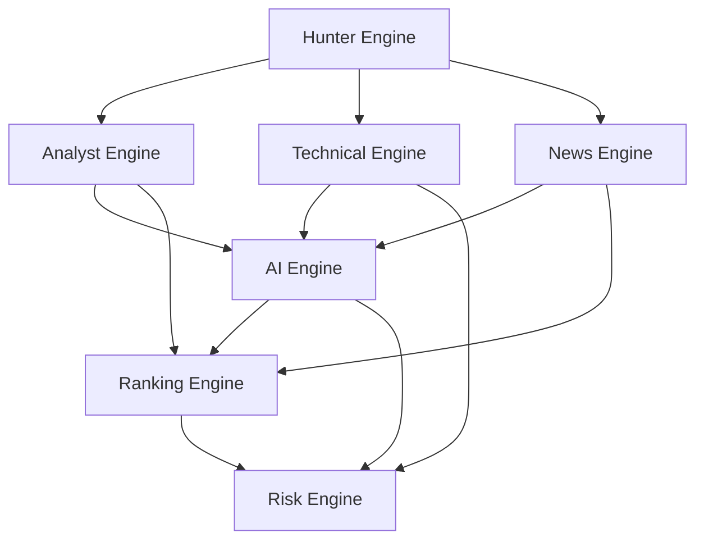

# Przepływ Danych w Systemie ALCHEMIK

## Silniki i ich role w systemie

### 1. Hunter Engine
1. **Cel modułu**: Gromadzenie surowych danych z różnych źródeł (np. API, bazy danych).
2. **Dane wejściowe**: Zapytania dotyczące danych, konfiguracja źródeł.
3. **Dane wyjściowe**: Surowce dane zebrane z różnych źródeł.
4. **Korzysta z modułów**: Brak (działa niezależnie).
5. **Przekazuje dane do**: Analyst Engine, Technical Engine, News Engine.
6. **Odpowiada za**: Zbieranie i wstępne przetwarzanie danych.
7. **Nie odpowiada za**: Analizę danych ani ich interpretację.

### 2. Analyst Engine
1. **Cel modułu**: Analiza zebranych danych w celu identyfikacji trendów i wzorców.
2. **Dane wejściowe**: Surowce dane od Hunter Engine.
3. **Dane wyjściowe**: Wyniki analizy (np. raporty, wykresy).
4. **Korzysta z modułów**: Hunter Engine.
5. **Przekazuje dane do**: AI Engine, Ranking Engine.
6. **Odpowiada za**: Interpretację danych i generowanie wniosków.
7. **Nie odpowiada za**: Podejmowanie decyzji na podstawie danych.

### 3. Technical Engine
1. **Cel modułu**: Techniczna obróbka danych (np. normalizacja, czyszczenie).
2. **Dane wejściowe**: Surowce dane od Hunter Engine.
3. **Dane wyjściowe**: Oczyszczone i przygotowane dane.
4. **Korzysta z modułów**: Hunter Engine.
5. **Przekazuje dane do**: AI Engine, Risk Engine.
6. **Odpowiada za**: Przygotowanie danych do dalszej analizy.
7. **Nie odpowiada za**: Interpretację danych.

### 4. News Engine
1. **Cel modułu**: Monitorowanie i przetwarzanie wiadomości związanych z danymi.
2. **Dane wejściowe**: Surowce dane od Hunter Engine.
3. **Dane wyjściowe**: Przetworzone wiadomości (np. streszczenia, tagi).
4. **Korzysta z modułów**: Hunter Engine.
5. **Przekazuje dane do**: AI Engine, Ranking Engine.
6. **Odpowiada za**: Dostarczanie aktualnych informacji.
7. **Nie odpowiada za**: Analizę wpływu wiadomości na dane.

### 5. AI Engine
1. **Cel modułu**: Wykorzystanie sztucznej inteligencji do zaawansowanej analizy danych.
2. **Dane wejściowe**: Dane od Analyst Engine, Technical Engine, News Engine.
3. **Dane wyjściowe**: Prognozy, rekomendacje, modele.
4. **Korzysta z modułów**: Analyst Engine, Technical Engine, News Engine.
5. **Przekazuje dane do**: Ranking Engine, Risk Engine.
6. **Odpowiada za**: Generowanie zaawansowanych wniosków.
7. **Nie odpowiada za**: Podejmowanie decyzji.

### 6. Ranking Engine
1. **Cel modułu**: Ocena i rankingowanie danych na podstawie różnych kryteriów.
2. **Dane wejściowe**: Dane od Analyst Engine, News Engine, AI Engine.
3. **Dane wyjściowe**: Rankingi, oceny.
4. **Korzysta z modułów**: Analyst Engine, News Engine, AI Engine.
5. **Przekazuje dane do**: Risk Engine.
6. **Odpowiada za**: Oceny i porównania danych.
7. **Nie odpowiada za**: Analizę ryzyka.

### 7. Risk Engine
1. **Cel modułu**: Ocena ryzyka związanego z danymi.
2. **Dane wejściowe**: Dane od Technical Engine, AI Engine, Ranking Engine.
3. **Dane wyjściowe**: Raporty ryzyka, alerty.
4. **Korzysta z modułów**: Technical Engine, AI Engine, Ranking Engine.
5. **Przekazuje dane do**: Brak (końcowy moduł).
6. **Odpowiada za**: Identyfikację i ocenę ryzyka.
7. **Nie odpowiada za**: Podejmowanie działań naprawczych.

## Schemat przepływu danych

